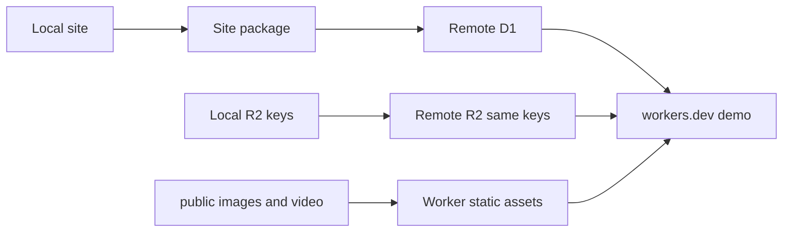

# Cloudflare demo deploy

There is no deploy playbook in this repository. The project is already wired the way [EmDash’s Cloudflare guide](https://docs.emdashcms.com/deployment/cloudflare/) describes, and [site transfer](https://docs.emdashcms.com/guides/site-transfer/) is the playbook for copying a local site onto a new deployment. Follow those two guides. Do not add a new doc.

The Worker, D1, and R2 bindings are already in place:

- [wrangler.jsonc](wrangler.jsonc) names the Worker `origin-japan`, D1 `origin-japan`, and R2 `origin-japan-media`, with the every-minute cron.
- [astro.config.mjs](astro.config.mjs) uses the Cloudflare adapter and EmDash `d1({ binding: "DB" })` / `r2({ binding: "MEDIA" })`.
- [src/worker.ts](src/worker.ts) exports the EmDash handler and scheduled publisher.

## What “local content” actually is

The live demo is the local D1 database plus local R2, not `seed/seed.json` alone.

- 33 vehicles (29 published), 5 pages, 3 reviews.
- Page and brand images in [public/](public/) (about 7 MB) ship with the Worker build as static assets. No separate upload.
- Listing photos are 599 objects, about 238 MB, in the local `origin-japan-media` bucket. They are referenced as `/_emdash/api/media/file/import-…` strings. The `media` table has **zero** rows, because [scripts/import-wordpress.ts](scripts/import-wordpress.ts) wrote the bytes straight to R2.

Site transfer copies media-library files and rewrites those references. These listing photos are not library rows, so the import will keep the URLs and warn `unknown_storage_key`. That is fine: EmDash’s file route serves any storage key, so the same keys must be uploaded to the remote bucket after the import.



## Deploy

1. Run `wrangler whoami`. If it is the wrong Cloudflare account, stop before creating resources.
2. `bun run build`, then `bunx wrangler deploy`. The first deploy creates the named D1 database and R2 bucket and prints a `workers.dev` URL. Keep that URL for the demo. A custom domain can wait: setup records the origin it runs on, and passkeys stick to that host.
3. Open the URL and finish the setup wizard. Create the demo admin. **Do not apply sample seed content.** Sample entries would block the import. Setup scaffold (collections and block types only) is what site transfer expects, and the import replaces it.
4. Check `.wrangler/deploy/config.json` for an `images` binding. The Cloudflare adapter adds it during build when the image service is left at its default. Originals still render if it is missing; transforms do not.

## Copy the site

5. With `bun dev` running, log in to local EmDash and export:

```bash
bunx emdash login --url http://localhost:4321
bunx emdash site export --url http://localhost:4321 --output /tmp/origin-japan.emdash
```

Write the package outside the repo. It contains entry content and email addresses, and it is not a seed file.

6. Log in to the deployed site and import into the empty site:

```bash
bunx emdash login --url https://origin-japan.<account>.workers.dev
bunx emdash site import /tmp/origin-japan.emdash --analyze
bunx emdash site import /tmp/origin-japan.emdash --plan <printed-digest> --confirm
```

Stop if analysis reports blockers. `unknown_storage_key` warnings for the `import-…` photo URLs are expected. Users and secrets are not in the package; the admin from step 3 remains.

7. Copy the 599 local R2 objects onto remote `origin-japan-media` under the same keys and content types, using Wrangler platform proxies (local binding to read, remote binding to write). The public file route will then resolve the URLs the import left unchanged.

## Check the demo

8. On the `workers.dev` URL, open the home page, stock, one priced listing with a gallery, and a sold listing. Confirm a listing photo returns 200 from `/_emdash/api/media/file/import-…`, and that a page image such as `/images/suzuki-carry-sunset-1400.jpg` loads from static assets. Sign in at `/_emdash/admin` with the account from setup.
